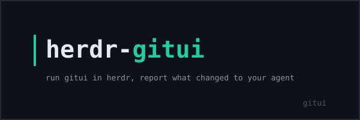

## herdr-git

[](https://github.com/alexeyco/herdr-git/releases/latest)
[](https://github.com/alexeyco/herdr-git/actions/workflows/ci.yml)
[](LICENSE)
[](https://github.com/alexeyco/herdr-git/releases/latest)
[](https://www.rust-lang.org)
[](https://herdr.dev)



herdr plugin that opens [gitui](https://github.com/gitui-org/gitui) in a herdr pane and reports what the session changed to the agent.

[herdr](https://herdr.dev) is a terminal workspace manager and agent multiplexer; gitui is a blazing-fast terminal UI for git. This plugin bridges them: one keypress opens gitui straight into the TUI rooted at the repository, and when you quit gitui after committing, pushing, or switching branches, a short English summary of what changed is sent to the focused agent as a prompt. It targets the herdr plugin API v1 and runs on Linux and macOS (Windows untested). The pane layout — tab, split, overlay, zoom, or a centered popup — is configured in `config.toml`.

## Demo

One keypress opens gitui rooted at the repository; when you quit gitui after a commit, a branch switch, or a push, the changes arrive in the focused agent as a single prompt.

<!-- TODO: record a short demo GIF or asciinema cast (keypress → gitui TUI → summary delivered) and embed here; keep it under ~15s -->

## Other herdr plugins

- [herdr-review](https://github.com/alexeyco/herdr-review) — review diffs with the human review TUI of your choice and deliver your annotations to the agent in the focused pane.
- [herdr-open-in](https://github.com/alexeyco/herdr-open-in) — open the workspace or worktree in your editor.

## Install

```
herdr plugin install alexeyco/herdr-git
```

The installer fetches the repository, runs `cargo build --release`, and registers the plugin.

## Quickstart

Bind a key in your herdr config:

```toml
[[keys.command]]
key = "prefix+shift+g"
type = "plugin_action"
command = "alexeyco.gitui.open"
description = "Open gitui"
```

Or invoke the action from the CLI:

```
herdr plugin action invoke alexeyco.gitui.open
```

## Why

- **Instant TUI.** Plugin pane commands are argv-exec, not send-text, so there is no shell layer and no echoed command line before gitui appears.
- **Read-only observation.** The plugin takes before/after git snapshots with read-only probes; it never writes to the git index or tree.
- **Agent-agnostic.** The summary goes to whichever agent herdr reports in the focused pane; no agent kind is special-cased.
- **Configurable layout.** Tab, split beside the caller pane, overlay, zoom, or a centered popup — through `config.toml`.
- **Kept summaries are pruned.** Session summaries that cannot be delivered stay on disk and are pruned automatically after 7 days.
- **Linux and macOS, ARM included.** Release binaries cover `x86_64` and `aarch64` on both platforms.

## Requirements

- herdr >= 0.9.0
- [gitui](https://github.com/gitui-org/gitui) on `PATH` (no minimum version is enforced)
- Rust toolchain 1.96.1 (the plugin builds itself on install)

Release binaries are unsigned. macOS may quarantine them on first run; `xattr -d com.apple.quarantine <path>` clears the quarantine flag until the binaries are signed and notarized.

## Usage

Any chord works; see the [herdr keyboard docs](https://herdr.dev/docs/keyboard/) for picking one that your terminal doesn't swallow.

The action resolves the repository directory from the plugin context and execs gitui directly in the pane, so it opens straight into the TUI. When you quit gitui, the plugin compares read-only before/after git snapshots and builds an English summary of what changed:

| Situation                           | What is reported                                       |
| ----------------------------------- | ------------------------------------------------------ |
| New commits                         | Each commit (up to 10) with short hash and subject     |
| Amend or rebase                     | HEAD moved from one commit to another (non-linear)     |
| Reset                               | HEAD moved back to an ancestor                         |
| Branch switch (incl. detached HEAD) | New branch name, or detached HEAD short sha            |
| Push (ahead-count decrease)         | Number of commits pushed to the upstream               |
| Staging deltas                      | Increase in staged, unstaged, or untracked file counts |

Example prompt delivered to the agent:

```
gitui session summary:

- switched to branch feature-x
- created commit abc1234: fix: handle edge case
- pushed 2 commit(s) to origin/feature-x
```

Nothing changed → nothing is sent. Closing the pane early cancels the session (no summary is delivered). Failure paths hold the pane until you press Enter so the error message stays readable.

## Configuration

An optional flat-key `config.toml` in the plugin's config directory controls where the gitui pane opens:

```toml
placement = "split"
direction = "down"
```

or, for a centered popup sized in outer terminal cells or percentages of the terminal area:

```toml
placement = "popup"
width = 80
height = "80%"
```

| Key         | Values                                       | Default   | Notes                                                 |
| ----------- | -------------------------------------------- | --------- | ----------------------------------------------------- |
| `placement` | `tab`, `split`, `overlay`, `zoomed`, `popup` | `tab`     | How the gitui pane is placed in the layout            |
| `direction` | `right`, `down`, `auto`                      | `right`   | Split direction; used only when `placement = "split"` |
| `width`     | Positive integer or `"N%"` string            | _(unset)_ | Popup width; used only when `placement = "popup"`     |
| `height`    | Positive integer or `"N%"` string            | _(unset)_ | Popup height; used only when `placement = "popup"`    |

`split` and `zoomed` open beside or over the caller pane — the plugin passes `--target-pane` with the id of the pane that triggered the action. If no caller pane resolves, a configured `split`/`zoomed` degrades to `tab` with a warning instead of failing the open. `popup` opens gitui as a centered session-modal window: it leaves the tiled layout untouched, receives all terminal input including Escape, and closes when gitui quits. `width`/`height` apply only to the popup placement; values below herdr's popup minimum are clamped by the daemon.

Settings are read once per action launch, so an edit takes effect on the next launch. The plugin never fails over its settings: a missing `config.toml` silently means defaults, while a corrupt file, an unknown key, or an invalid value degrades to the defaults for that key with a warning you can see via `herdr plugin log list`. Focus is not configurable: the pane always opens focused.

The file lives in the plugin's config directory: herdr injects its location as `HERDR_PLUGIN_CONFIG_DIR`, and `herdr plugin config-dir alexeyco.gitui` prints the same directory for you to edit in a shell.

## How it works

The full detection rules and lifecycle are in [docs/how-it-works.md](docs/how-it-works.md).

## Building

```
git clone https://github.com/alexeyco/herdr-git
cd herdr-git
cargo build --release
herdr plugin link .
```

To run your own build inside herdr panes, keep the plugin linked; a linked plugin does not rebuild itself.

## Changelog

See [CHANGELOG.md](CHANGELOG.md).

## Contributing

See [CONTRIBUTING.md](CONTRIBUTING.md).

## License

[MIT](LICENSE)
